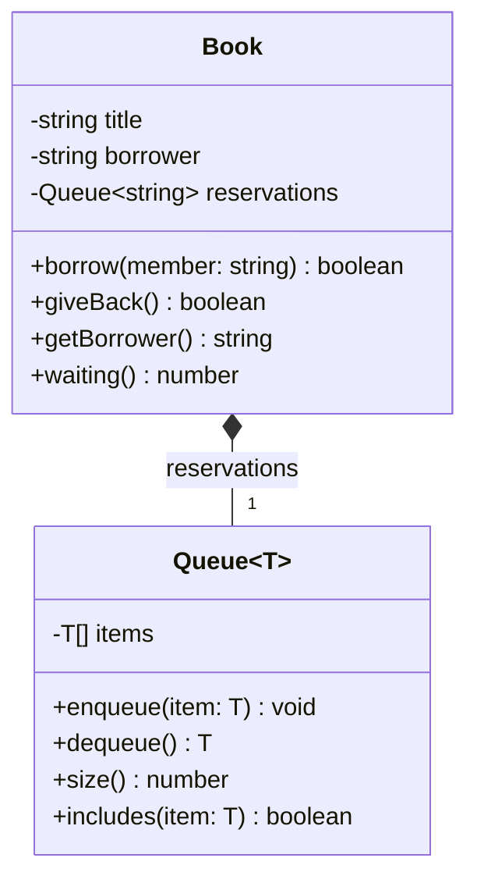

# Lab 4 — Predictions and Answers (Parts 1–5)

## Predictions

1. `any` suppresses type errors, so the editor shows no red underline. Running the `AnyList` test prints `Awa`, then throws a `TypeError` because a `Member` has no `describe()` method. `memberList.add(42)` is not caught by the editor and throws at runtime when `add` calls `item.getId()`.
2. Replacing the array with a `Map` changes no test lines; the output stays the same as Checkpoint 1.
3. For `mostCostly([novel, laptop], 3)`, TypeScript infers `Book | Laptop | undefined`. After checking that the result exists, `describe()` is not available on the union because `Laptop` has no such method.
4. `instanceof T` is a type error because a type parameter is not a runtime constructor. If run despite the error, it stops with a `ReferenceError` because `T` is not defined at runtime.
5. The first line prints `Things Fall Apart`; the second prints `NaN`, because the JSON object has no `copies` value.

## Questions

### Question 1

The `any` version gives up static type checking: it allows invalid values and calls that may fail at runtime. `memberList.add(42)` is not caught by the editor and throws at runtime when `add` tries to call `getId()` on the number.

### Question 2

TypeScript reports that `getId` does not exist on type `T` at both calls. Without a constraint, `T` could be any type, including one with no `getId` method.

### Question 3

TypeScript uses structural typing. Both classes have a public `getId(): string` method, so each satisfies `HasId` without explicitly declaring `implements HasId`.

### Question 4

- (a) A `Member` cannot be added to `Catalog<Book>` because the catalog's type parameter is fixed to `Book`; the `T` type on `Catalog` and `add` enforces this.
- (b) `number` is rejected because it does not have `getId(): string`; the `T extends HasId` constraint enforces this.
- (c) The result may be `undefined`, so calling `describe()` without narrowing is unsafe; the `T | undefined` return type requires checking first.

### Question 5

The implementation changed, but the public `Catalog` methods and their types did not. The tests use that interface rather than depending on its internal storage, which is encapsulation.

### Question 6

For example: `books.all().push(new Book("B-001", "Duplicate"));`. If `all()` returned the internal array, callers could insert a duplicate without using `add`. Returning a new array prevents array mutations by the caller from changing the catalog's stored collection.

### Question 7

The error is: `Property 'describe' does not exist on type 'Borrowable'.` The declared return type is only `Borrowable`, whose contract includes `lateFee` but not `describe`; the compiler cannot assume the concrete object is a `Dvd`.

### Question 8

A generic is useful when the function returns a value whose type depends on the input type. `mostCostly` returns one of the input items, so it preserves `T`. With mixed inputs, `T` is inferred as `Book | Laptop`; only members common to both types (such as `lateFee`) can be called safely.

### Question 9

`T` is chosen when constructing the queue, as in `new Queue<string>()`; here `T` is `string`. If `Book` extended `Queue<string>`, code such as `book.enqueue("Moussa")` could change the inherited queue directly without applying `Book.borrow`'s rules.

### Question 10

The first `false` means Moussa was added to the reservation queue because Awa had the book. The second means he was already waiting, so nothing changed. A `boolean` cannot tell the caller which of those two outcomes occurred.

### Question 11

`Book` has a composition relationship with `Queue<string>`: the queue is a private part used to manage reservations, not a kind of book. One book has one queue, and that queue holds zero or more member names.

### Question 12

Node strips TypeScript's type syntax rather than enforcing types at runtime; type parameters disappear, and a generic annotation such as `parseJson<BookData[]>` does not validate parsed data. `instanceof T` therefore fails because there is no runtime `T`, while the unchecked JSON value has no `copies` property and arithmetic yields `NaN`. Data from outside the program must be validated at runtime before it is trusted.

## Part 4 class diagram

